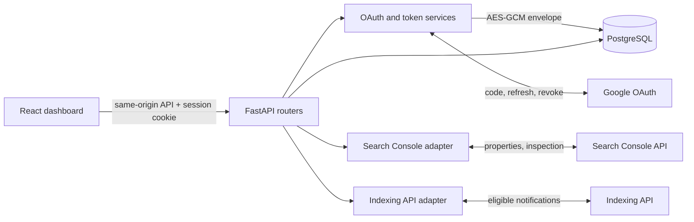

# Architecture

The repository is a modular monolith. `apps/api` owns identity context, OAuth transactions, encrypted token persistence, Google HTTP adapters, and audit history. `apps/web` is a same-origin-proxied React UI; browser storage never receives OAuth credentials.

PostgreSQL is the source of truth. OAuth state records expire after ten minutes and are deleted before code exchange. Google calls have explicit timeouts. API errors are mapped to safe client messages. Migrations are managed by Alembic. The current rate limiting is a single-process design and must move to shared infrastructure for multi-replica deployments.
